# User guide

EnvBao Admin lets you manage who can reach which secrets in OpenBao without writing policy HCL, and shows the result as a graph. This guide walks through the screens. If you are setting EnvBao up, see the [administrator guide](admin-guide.md).

The screenshots use the demo stack (`docker compose up`), whose sample data has users `alice`, `bob` and `carol`.

## Contents

- [Signing in](#signing-in)
- [Identities](#identities)
- [Giving someone access](#giving-someone-access)
- [Secrets](#secrets)
- [Dynamic secrets engines](#dynamic-secrets-engines)
- [Managing secrets engines](#managing-secrets-engines)
- [The access graph](#the-access-graph)
- [Good to know](#good-to-know)

## Signing in

Open the UI and choose **Connect**. Enter the OpenBao URL and either a **token**, or choose **Userpass** and enter a username and password. Until you are signed in, only the Connect page is available.

When you are connected, the Connect page becomes a status page with the server's version and seal state and your session: who you are, your policies, and when the token expires. **Disconnect** signs you out.

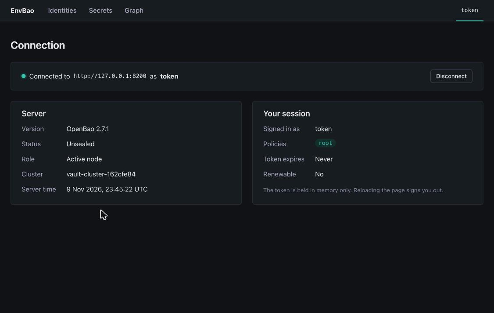

Your session lasts as long as your token. When it expires, is revoked, or OpenBao is sealed, a banner links you back to sign in. Reloading the browser page also signs you out, because the token is only kept in memory.

What you can do depends on your OpenBao policy. If an action is not allowed for your account, OpenBao's "permission denied" message is shown.

## Identities

**Identities** has four tabs.

| Tab | What it is |
| --- | --- |
| **Users** | Userpass logins (username and password) and the policies attached to them. |
| **Entities** | OpenBao identity entities, with their userpass aliases. An entity ties one person's logins together. |
| **Groups** | Identity groups. Members inherit the group's policies. |
| **Tokens** | Standalone tokens. |

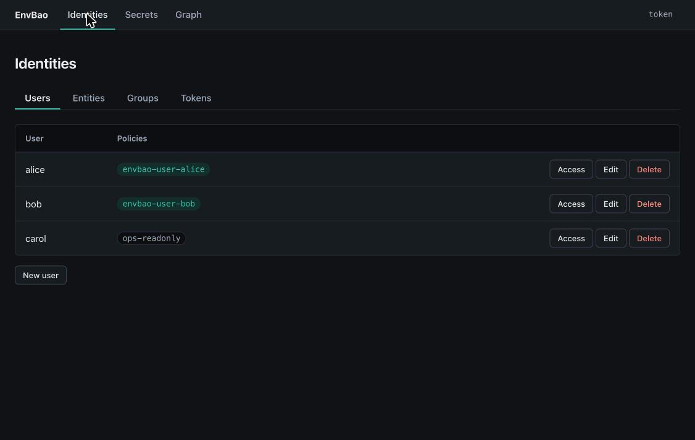

Each row has **Access**, **Edit** and **Delete**. Use **New user** (or New entity, New group) under the table to create one. Policy chips in the table are green when EnvBao manages the policy and grey for policies it only displays.

### Tokens

The Tokens tab lists live tokens with their policies, expiry and accessor. **New token** creates one: set a display name, TTL, policies and whether it is renewable or orphaned. **The token's value is shown once**, right after creation. Copy it then; it cannot be shown again. **Revoke** ends a token immediately. Your own token is marked "(you)" and cannot be revoked here.

A token's policies are fixed when it is created, so you cannot grant access to an existing token afterwards. Choose its policies up front.

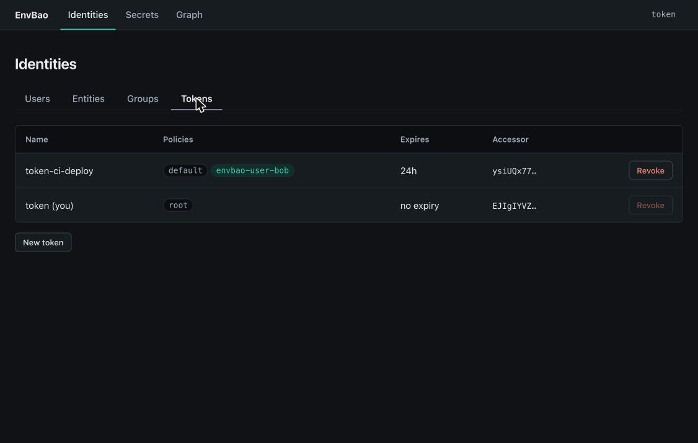

## Giving someone access

Click **Access** on a user, entity or group. The panel has two halves.

- **Granted by EnvBao** (left): what you have granted through this UI, with a **Revoke** button on each line, and a **Show policy HCL** link if you want to see the policy it writes. Below it, **Other policies** lists anything attached to the identity that was set up outside EnvBao. Those are shown read-only.
- **Grant access** (right): the form to add something.

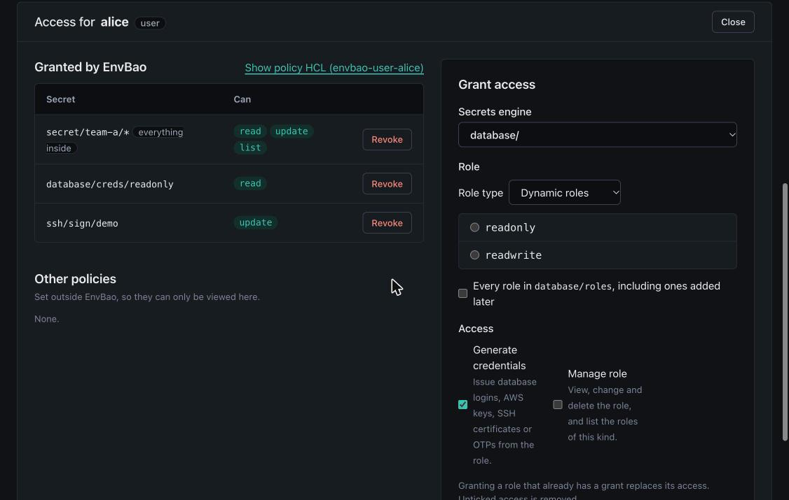

### Granting access to a secret

1. Pick the **secrets engine** (a KV mount such as `secret/`).
2. Enter a **path within the mount**, for example `app/database`, or a glob such as `app/*` for everything under `app/`.
3. Tick the capabilities: read, create, update, delete, list.
4. Press **Grant**.

You enter the path as it appears inside the mount. EnvBao writes the underlying `data/` and `metadata/` policy paths for you. Granting a path that already has a grant replaces its capabilities.

### Granting access to a dynamic-engine role

Choose a database, AWS or SSH engine instead of KV, then pick a **role**, or tick *every role in the engine* to cover roles added later. Two permissions are offered:

- **Generate credentials**: the identity may request database logins, AWS keys, SSH certificates or one-time passwords from the role.
- **Manage role**: the identity may view, change and delete the role and list the engine's roles.

Unticking a permission and granting again removes it.

### How it is stored

For each identity, EnvBao keeps one policy named `envbao-<kind>-<name>` (for example `envbao-user-alice`). Edit such a policy outside EnvBao and the UI will show it read-only instead of overwriting your change.

## Secrets

**Secrets** is where you browse and manage secrets engines. At the top:

- **New secrets engine** adds a mount (see [Managing secrets engines](#managing-secrets-engines)).
- The **Secrets engine** drop-down chooses which engine to work with, with **Settings** and **Delete** for that engine beside it.

For a **KV** engine you browse folders and secrets with the breadcrumb under the toolbar. Select a secret to see **who can reach it**: every identity with access, through which policy, and with which capabilities. **Grant access** on that panel opens the grant form for the secret.

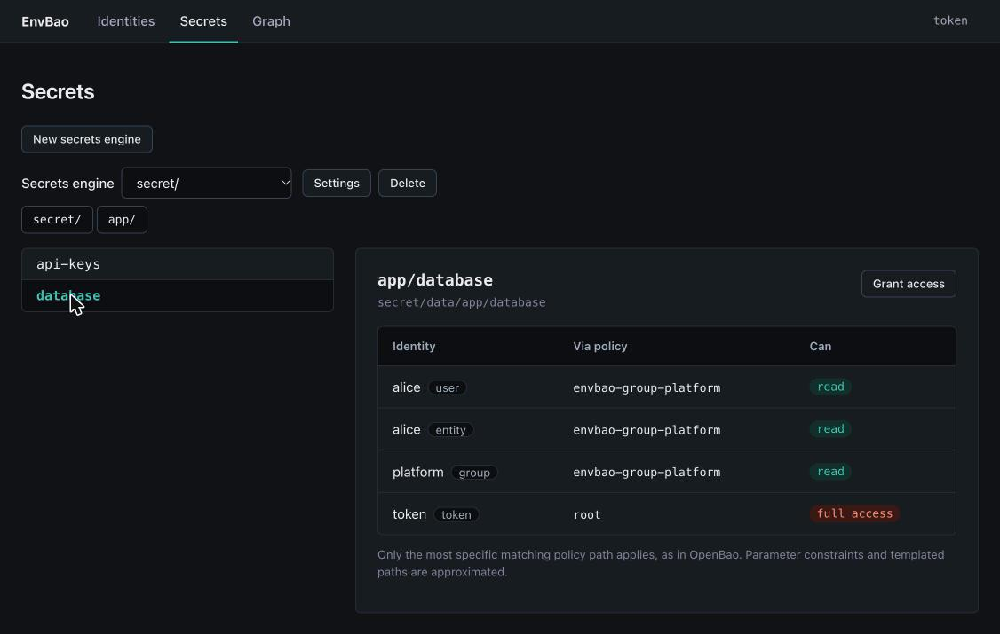

EnvBao shows secret **names only**. It never reads or displays a secret's value. OpenBao applies the most specific matching policy path, and the table follows the same rule. It does not evaluate parameter constraints, control groups, MFA or templated paths (templated paths are approximated), so a policy using those may be over-reported and is flagged.

## Dynamic secrets engines

Database, AWS and SSH engines issue short-lived credentials on request instead of storing fixed secrets. Choosing one of these engines shows three tabs: **Roles**, **Config** and **Leases**. Any other engine type gets a raw JSON role editor only.

### Roles

A role describes what to hand out: for the database engine, the SQL that creates a login and its TTLs; for SSH, the certificate rules; for AWS, the policy or IAM settings. The database engine has **Dynamic roles** (a new login each time) and **Static roles** (one fixed login whose password OpenBao rotates).

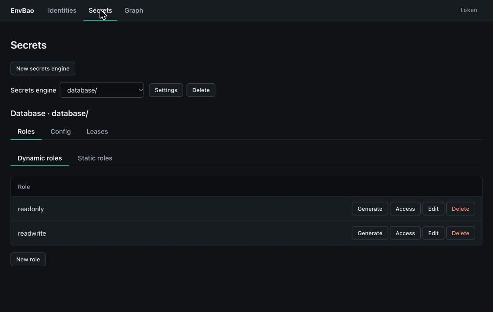

- **New role** creates one, and **Edit** changes it. TTLs accept values like `30m` or `1h`. Multi-statement SQL fields take statements separated by a blank line.
- **Access** shows who can already use the role, and lets you grant it.
- **Delete** removes the role. Credentials already issued from it stay valid until their leases end.

### Generate credentials

**Generate** asks OpenBao for credentials from the role: a database login, AWS keys, a signed SSH certificate (paste a public key first), or a one-time password. They appear **once**. Copy them straight away; they are not stored and cannot be shown again. **Revoke now** ends the lease immediately.

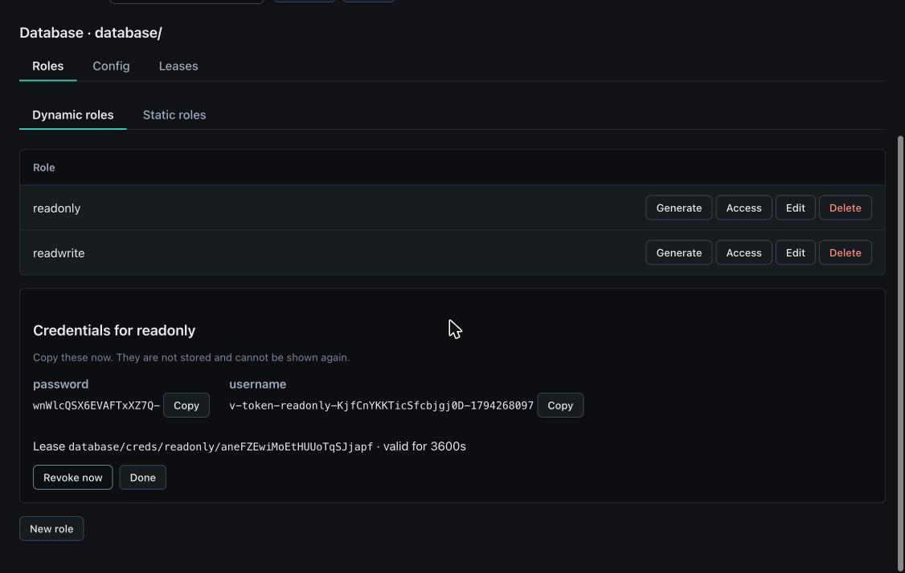

### Config

Engine-level settings. For the database engine this is the list of **connections**: the connection URL (with `{{username}}` and `{{password}}` templates), and the roles each connection allows. You can add a connection, edit one, rotate its root credentials and reset it. For SSH it is the signing CA; for AWS the root credentials and lease settings. Password and private-key fields are **write-only**: leave one blank when editing to keep the stored value.

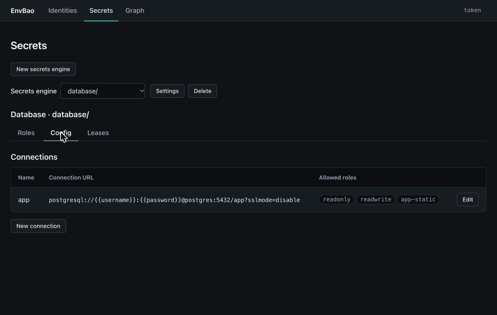

### Leases

Every credential an engine issues has a lease. The tab lets you browse them by role, open **Details** (issued, expires, time remaining, last renewal), **Renew** one if it is renewable, **Revoke** one, or **Revoke all under this prefix** for everything beneath the folder you are in. Revoking makes the credentials stop working at once. Credentials with no lease, such as database static roles, cannot be revoked here.

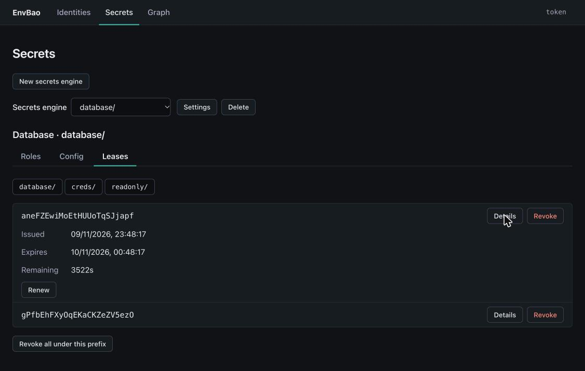

## Managing secrets engines

### Create

**New secrets engine** opens a form. Choose a **type** (KV v2, database, AWS or SSH), a **path** (lower-case letters, digits, `-` and `_`, with optional `/` segments; it cannot overlap an existing mount or use a reserved name like `sys`), an optional description, and the type's settings: for KV, max versions, check-and-set and automatic version deletion; for the others, default and maximum lease TTLs. The new engine is selected when it has been created.

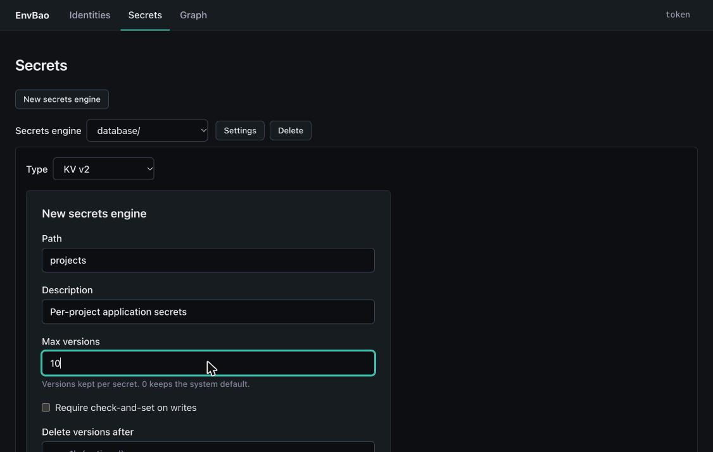

If creating a KV engine succeeds but saving its KV settings fails, the page says so, and the engine remains mounted.

### Change

**Settings** edits the description and the settings above. The path and type cannot be changed, and there is no rename.

### Delete

**Delete** asks you to type the engine's path before it will proceed, and tells you what you would lose: the number of secrets, roles or leases, and the policies that still mention the engine. Deleting an engine permanently destroys everything in it and revokes all its leases. **It cannot be undone.** Policies that refer to a deleted engine are left in place.

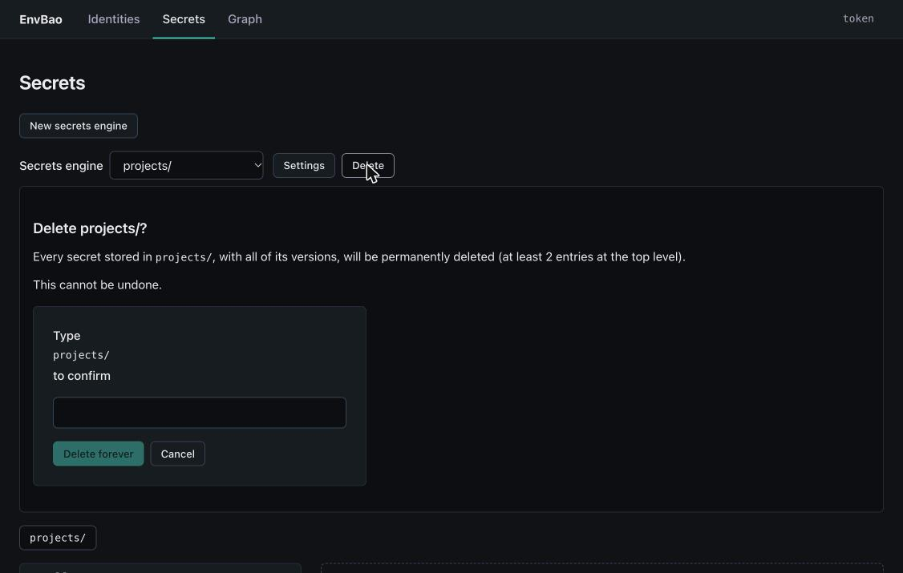

## The access graph

**Graph** draws identity → policy → path. Identities are on the left, policies in the middle and the paths they grant on the right, with capabilities on the lines. Bold policies are managed by EnvBao, and a dashed policy is attached to something but does not exist. Identities include the policies they inherit through entities and groups.

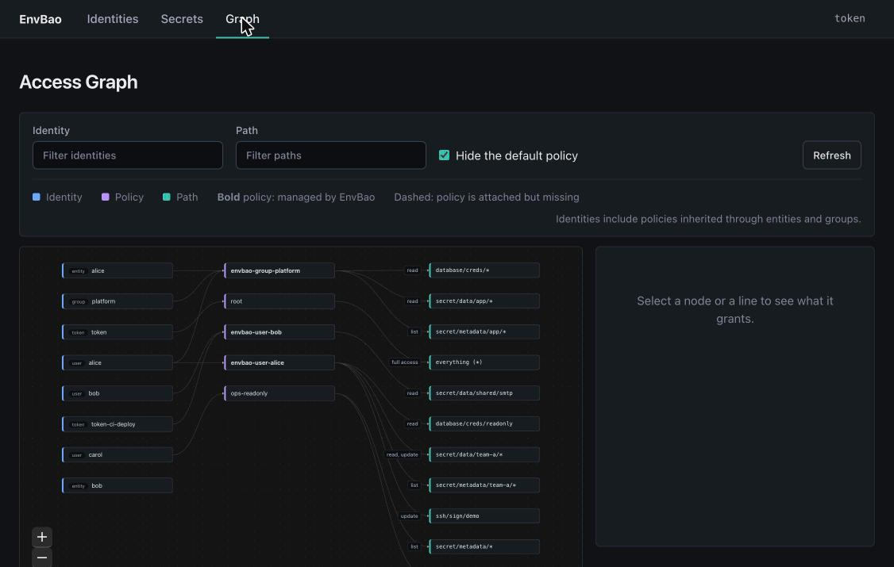

- **Click a box** to highlight every line connected to it and fade the rest; the side panel shows its details.
- **Click a line** between a policy and a path to see the grant, and revoke it.
- Use the **Identity** and **Path** filters to narrow a busy graph, **Hide the default policy** to cut noise, and **Refresh** to reload.
- Zoom and pan with the controls or your mouse.

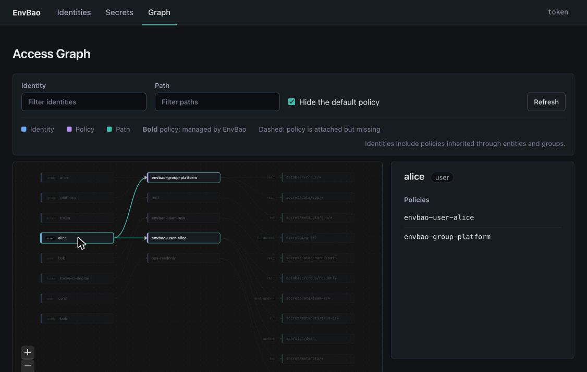

## Good to know

- **Copy it now.** Tokens and generated credentials are shown once only.
- **Names, not values.** Secret values are never shown.
- **Whole-instance reads.** The graph and Access panels read every user, entity, group, token and policy each time they load, which can be slow on very large instances.
- **Not everything is managed here.** Auth methods other than userpass, nested groups and non-userpass aliases are not followed, and KV v1 mounts are not shown. See the README's limitations for the full list.
- **Policies you did not create are read-only.** Change those with the OpenBao CLI.
